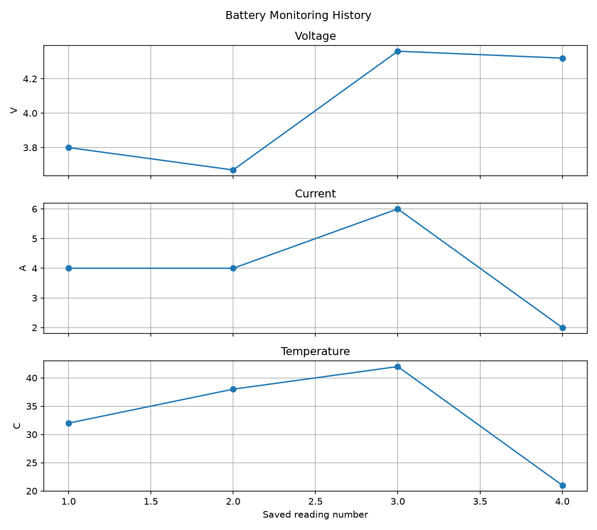

# Smart Battery Health Monitoring System

A Python-based battery monitoring and diagnostic system that processes simulated battery measurements, identifies abnormal operating conditions, stores readings, and visualizes battery performance.

## Features

- Monitor battery voltage, current, and temperature
- Calculate electrical power
- Classify battery status as HEALTHY, WARNING, or CRITICAL
- Save battery readings with timestamps in CSV format
- View recorded measurements and summaries
- Visualize battery measurements using Matplotlib
- Analyze saved battery readings to identify minimum and maximum voltage, highest temperature, and percentage of healthy readings.

## Screenshots

### Battery Monitoring Graph

The graph displays recorded voltage, current, and temperature measurements over time.



## Technologies

- Python
- Matplotlib
- CSV file handling
- Python unittest

## Installation

Install the required dependencies:

```bash
python -m pip install -r requirements.txt
```

## Running the Application

```bash
python battery_monitor.py
```

Follow the interactive menu to record readings, view history, and generate graphs.


## Automated Testing

This project uses Python's built-in `unittest` framework to verify battery monitoring functions.

Run the automated tests from the project directory:

```bash
python -m unittest discover -s tests -v
```

The tests cover voltage classification, temperature classification, boundary values, and HEALTHY, WARNING, and CRITICAL battery conditions.

## Project Purpose

This project demonstrates Python programming, conditional logic, loops, functions, electrical calculations, data handling, and visualization.

**Note:** The battery readings are manually supplied, and the thresholds are illustrative. This software is an educational simulation, not a certified battery safety system.
