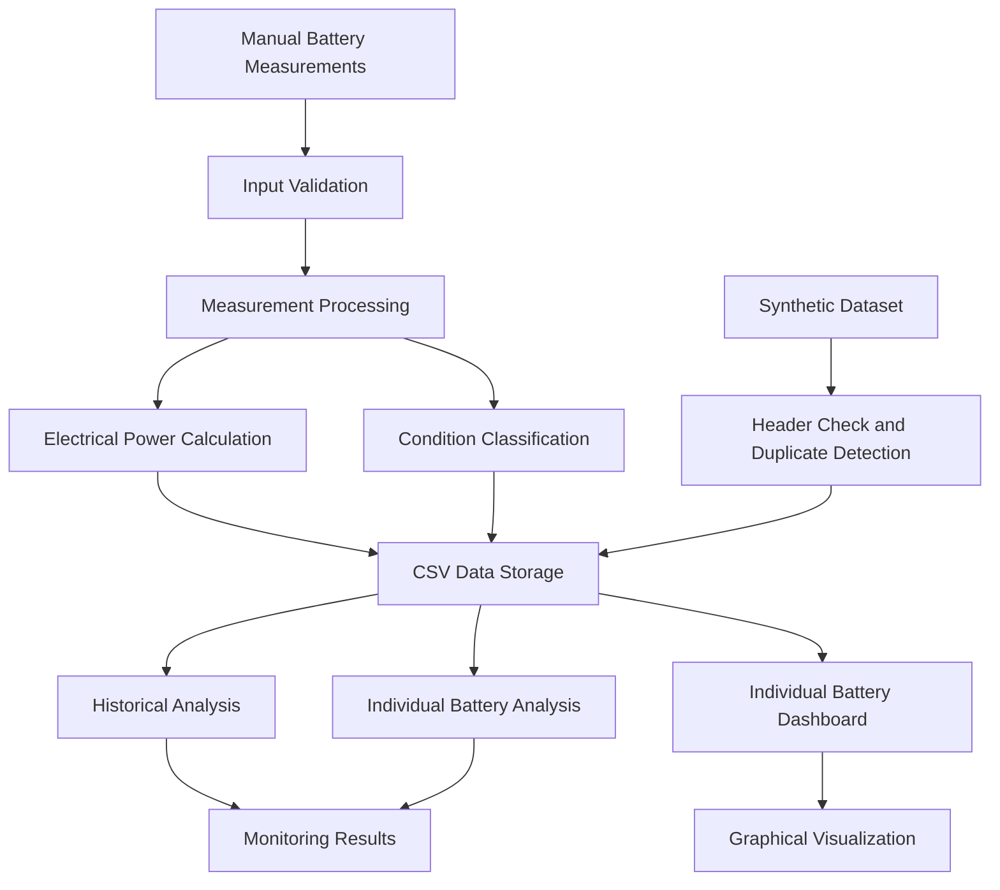
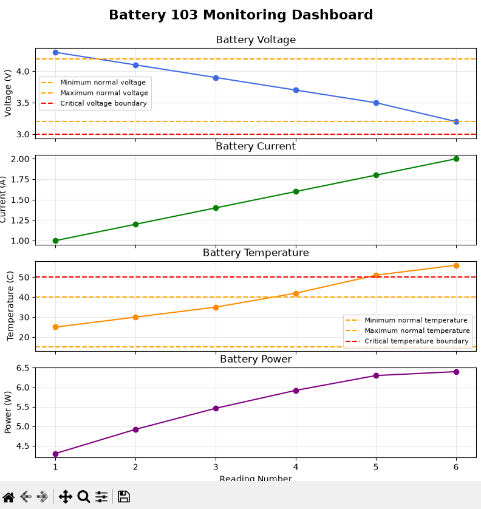
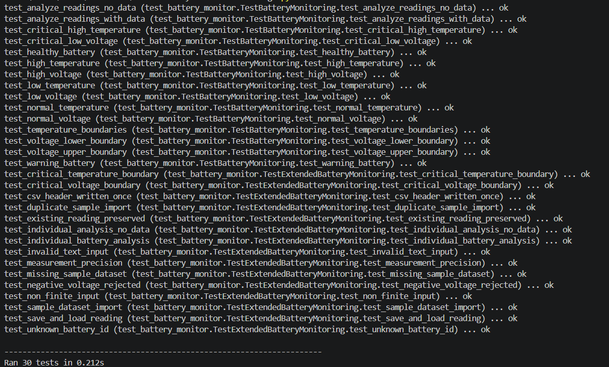

# Smart Battery Health Monitoring System

[](https://github.com/ShanmukhJonnalagadda/Smart-Battery-Health-Monitoring/actions/workflows/tests.yml)


A Python-based battery monitoring and diagnostic system
that integrates electrical measurement processing,
threshold-based condition classification, persistent data
logging, individual battery analysis, and graphical
visualization.

The system demonstrates the application of electrical
engineering principles and software engineering practices
to battery operating condition monitoring.

## Project Highlights

| Metric | Result |
|---|---|
| Automated regression tests | 30/30 passed locally |
| Local test execution time | 0.212 seconds |
| Python versions tested | 3.11, 3.12, 3.13 |
| Synthetic battery measurements | 18 |
| Simulated batteries | 3 |
| Monitored parameters | Voltage, current, temperature, power |
| Operating condition classifications | HEALTHY, WARNING, CRITICAL |
| Continuous integration | GitHub Actions |
| Individual battery dashboards | 3 manually validated |

## 1. Problem Statement

Battery-powered systems require monitoring of electrical
and thermal operating conditions to identify abnormal
behavior.

Without structured measurement logging and analysis,
identifying abnormal voltage conditions, elevated
temperatures, and historical performance trends can be
difficult.

This project addresses these challenges through a
software-based educational monitoring platform that
processes battery measurements, identifies abnormal
operating conditions, and provides reproducible analysis
and visualization.

## 2. Features

- Voltage, current, and temperature monitoring
- Electrical power calculation using P = V × I
- Threshold-based operating condition classification
- Numeric input validation
- Timestamped CSV data logging
- Measurement precision preservation
- Historical measurement analysis
- Independent monitoring of multiple battery IDs
- Individual battery performance analysis
- Synthetic dataset integration
- Duplicate sample import prevention
- Four-parameter battery monitoring dashboards
- Voltage and temperature threshold visualization
- 30 automated regression tests
- GitHub Actions continuous integration

## 3. System Architecture



The system separates measurement acquisition, processing,
classification, storage, analysis, and visualization into
individual Python functions.

This organization supports maintainability, debugging,
and automated verification.

## 4. Battery Condition Classification

The system evaluates voltage and temperature using
illustrative operating thresholds.

### Voltage Thresholds

| Voltage | Classification |
|---|---|
| Below 3.2 V | Low |
| 3.2–4.2 V, inclusive | Normal |
| Above 4.2 V | High |
| Below 3.0 V | Critical overall condition |

### Temperature Thresholds

| Temperature | Classification |
|---|---|
| Below 15°C | Too Cold |
| 15–40°C, inclusive | Normal |
| Above 40°C | High |
| Above 50°C | Critical overall condition |

### Overall Operating Condition

| Status | Classification Rule |
|---|---|
| CRITICAL | Voltage below 3.0 V or temperature above 50°C |
| HEALTHY | Voltage and temperature both within normal ranges |
| WARNING | All remaining conditions |

Critical conditions take priority over warning and
healthy classifications.

Current and power are monitored and visualized but do
not determine the overall operating condition.

## 5. Electrical Power Calculation

Electrical power is calculated using:

P = V × I

For example:

- Voltage: 3.8 V
- Current: 1.5 A
- Electrical power: 5.7 W

The calculated power and original measurements are stored
for historical analysis.

## 6. Individual Battery Monitoring Dashboards

Each dashboard contains four plots:

- Battery voltage
- Battery current
- Battery temperature
- Electrical power

Measurements are filtered by battery ID and sorted
chronologically. Voltage and temperature plots display
the configured operating boundaries.

### Battery 101 — Critical Undervoltage and Overheating


Battery 101 demonstrates decreasing voltage and increasing
temperature. The final measurement crosses both critical
operating boundaries.

### Battery 102 — Elevated Temperature


Battery 102 maintains voltage within the normal range
but exhibits elevated temperatures during the final
two measurements.

### Battery 103 — High Voltage and Critical Temperature



Battery 103 demonstrates an initial high-voltage warning
followed by critical high-temperature conditions.

## 7. Synthetic Dataset and Analysis

The repository includes a reproducible synthetic dataset
containing 18 measurements from three simulated batteries.

[View Sample Dataset](data/sample_battery_readings.csv)

### Dataset Analysis Results

| Parameter | Battery 101 | Battery 102 | Battery 103 |
|---|---:|---:|---:|
| Total readings | 6 | 6 | 6 |
| Minimum voltage | 2.90 V | 3.30 V | 3.20 V |
| Maximum voltage | 4.10 V | 4.20 V | 4.30 V |
| Maximum current | 1.80 A | 1.70 A | 2.00 A |
| Maximum temperature | 52°C | 48°C | 56°C |
| Maximum power | 5.70 W | 5.61 W | 6.40 W |
| Healthy readings | 4 | 4 | 2 |
| Warning readings | 1 | 2 | 2 |
| Critical readings | 1 | 0 | 2 |
| Healthy reading percentage | 66.7% | 66.7% | 33.3% |

### Overall Condition Distribution

| Condition | Count | Percentage |
|---|---:|---:|
| HEALTHY | 10 | 55.6% |
| WARNING | 5 | 27.8% |
| CRITICAL | 3 | 16.7% |

Percentages are rounded independently.

The dataset demonstrates the application's ability to
classify different operating conditions and independently
analyze multiple batteries.

## 8. Technologies and Engineering Skills

| Technology | Application |
|---|---|
| Python | Application development and measurement processing |
| Matplotlib | Electrical and thermal data visualization |
| CSV | Persistent measurement storage |
| unittest | Automated regression testing |
| unittest.mock | Input simulation and test isolation |
| pathlib | File and directory management |
| Git | Version control |
| GitHub Actions | Continuous integration |

Engineering concepts demonstrated include:

- Electrical power calculations
- Battery operating condition monitoring
- Threshold-based fault classification
- Boundary condition analysis
- Measurement data processing
- Software verification and validation
- Regression testing
- Data visualization

## 9. Repository Structure

```text id="ns5amv"
Smart-Battery-Health-Monitoring/
├── .github/
│   └── workflows/
│       └── tests.yml
├── data/
│   └── sample_battery_readings.csv
├── docs/
│   ├── system_design.md
│   └── validation.md
├── images/
│   ├── Battery_Chart_101.png
│   ├── Battery_Chart_102.png
│   ├── Battery_Chart_103.png
│   └── test_results.png
├── tests/
│   └── test_battery_monitor.py
├── battery_monitor.py
├── requirements.txt
├── README.md
├── .gitignore
└── LICENSE
```

Generated runtime files, including `battery_readings.csv`
and `battery_chart.png`, are stored locally and excluded
from version control.

## 10. Installation and Setup

### Prerequisites

- Python 3.11, 3.12, or 3.13
- Git
- pip

### Clone the Repository

```bash id="4amfnd"
git clone https://github.com/ShanmukhJonnalagadda/Smart-Battery-Health-Monitoring.git

cd Smart-Battery-Health-Monitoring
```

### Install Dependencies

```bash id="ixdl6g"
python -m pip install -r requirements.txt
```

### Run the Application

```bash id="0kr43s"
python battery_monitor.py
```

## 11. Application Usage

```text id="fxs9tn"
Smart Battery Health Monitoring System
Educational battery monitoring simulation.

1. Take a battery reading
2. View the last five readings
3. View monitoring summary
4. Make a graph
5. Analyze battery data
6. Analyze an individual battery
7. Load sample battery dataset
8. Exit
```

### Quick Demonstration

1. Run the application.
2. Select option 7 to import the synthetic dataset.
3. Select option 3 to view the monitoring summary.
4. Select option 6 and enter battery ID 101 for individual analysis.
5. Select option 4 and enter battery ID 101 to generate a dashboard.
6. Repeat for battery IDs 102 and 103.

On the first sample import into an empty data file:

```text id="f9hnu0"
Sample readings imported: 18
Duplicate readings skipped: 0
```

Repeated imports are prevented using the combination
of measurement timestamp and battery ID.

The application saves the generated graph as
`battery_chart.png`. Generating another dashboard
replaces the previous output file.

## 12. Automated Testing

The project includes 30 automated regression tests.

Run the complete test suite:

```bash id="swgzij"
python -m unittest discover -s tests -v
```

### Test Coverage by Functional Area

| Test Category | Test Cases |
|---|---:|
| Voltage classification | 5 |
| Temperature classification | 4 |
| Overall operating condition | 4 |
| Historical data analysis | 2 |
| Sample dataset import | 2 |
| Duplicate import prevention | 2 |
| Individual battery analysis | 3 |
| CSV data persistence | 3 |
| Input validation | 3 |
| Critical threshold boundaries | 2 |
| Total | 30 |

### Local Regression Results

```text id="krdj55"
Ran 30 tests in 0.212s

OK
```



The recorded local test execution completed with no
failures or errors.

Temporary directories isolate automated test data from
existing application measurements.

The reported pass rate applies to the defined test cases
and does not represent complete source code coverage.

## 13. Continuous Integration

GitHub Actions automatically executes the regression
suite on pushes and pull requests.

Manual workflow execution is also supported.

| Python Version | Configured Tests | Verified Test Result |
|---|---:|---|
| Python 3.11 | 30 | PASS |
| Python 3.12 | 30 | PASS |
| Python 3.13 | 30 | PASS |

Each complete workflow is configured for 90 test
executions across three Python environments.

[View GitHub Actions Results](https://github.com/ShanmukhJonnalagadda/Smart-Battery-Health-Monitoring/actions)

## 14. Engineering Documentation

Detailed technical documentation is available below.

| Document | Description |
|---|---|
| [System Design Documentation](docs/system_design.md) | Architecture, algorithms, data flow, design decisions, and limitations |
| [Engineering Validation Report](docs/validation.md) | Automated test results, boundary testing, dashboard validation, and requirements verification |
| [Synthetic Dataset](data/sample_battery_readings.csv) | Reproducible multi-battery demonstration data |
| [Python Application](battery_monitor.py) | Complete monitoring application |
| [Regression Test Suite](tests/test_battery_monitor.py) | Automated software verification |

## 15. System Limitations

- Measurements are manually entered or synthetically generated.
- Physical battery sensor integration is not implemented.
- Operating thresholds are illustrative.
- Current and power are not used for condition classification.
- Battery state of charge and state of health are not estimated.
- Battery capacity degradation is not modeled.
- Automatic hardware protection is not implemented.
- Dashboard generation has been manually demonstrated but is
  not covered by the automated regression suite.
- Imported CSV measurements are assumed to be valid.

The HEALTHY classification indicates that a measurement
falls within the configured normal operating ranges.
It does not establish the electrochemical health of a
physical battery.

This application is an educational monitoring simulation,
not a certified battery management or protection system.

## 16. Future Improvements

- ESP32 or Arduino-based sensor integration
- Real-time voltage, current, and temperature acquisition
- Configurable battery-specific thresholds
- Overcurrent detection
- Battery state-of-charge estimation
- State-of-health estimation using capacity measurements
- MQTT-based remote monitoring
- SQLite database integration
- Automated dashboard testing
- Hardware-in-the-loop validation

## 17. License

This project is licensed under the MIT License.

See the [LICENSE](LICENSE) file for details.

## Author

Sai Shanmukhnath Jonnalagadda

Graduate Student — Electrical Engineering

George Mason University

[GitHub Profile](https://github.com/ShanmukhJonnalagadda)
