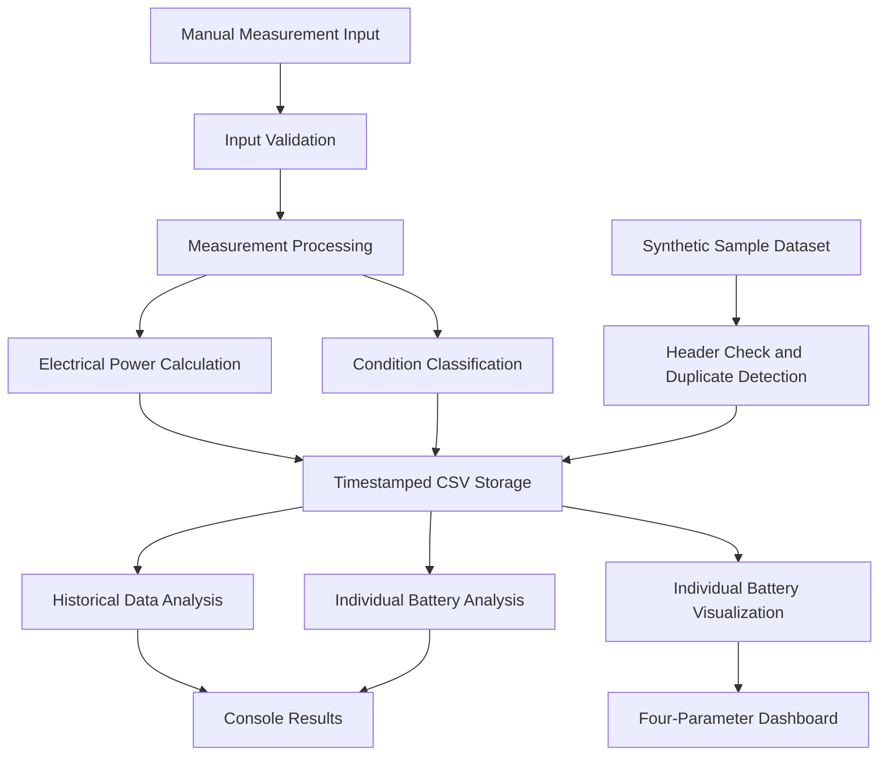
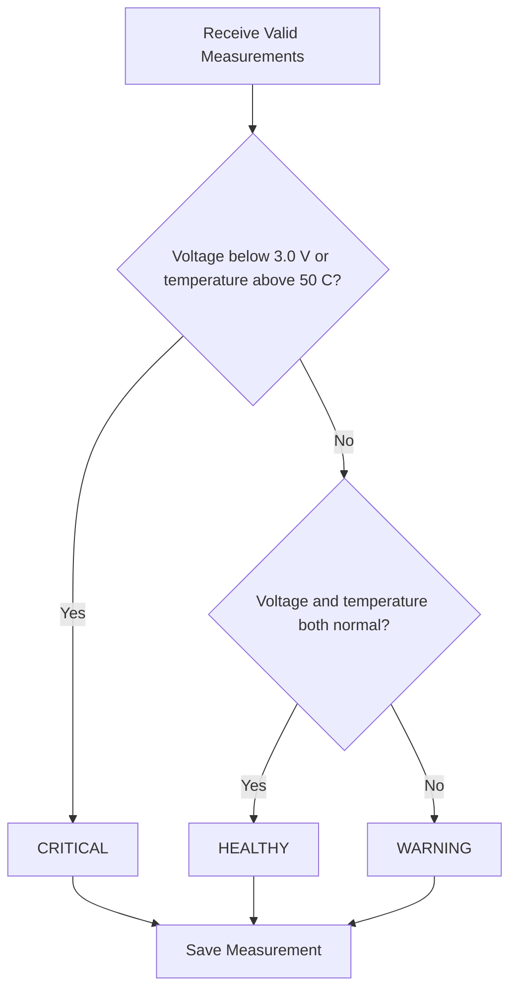
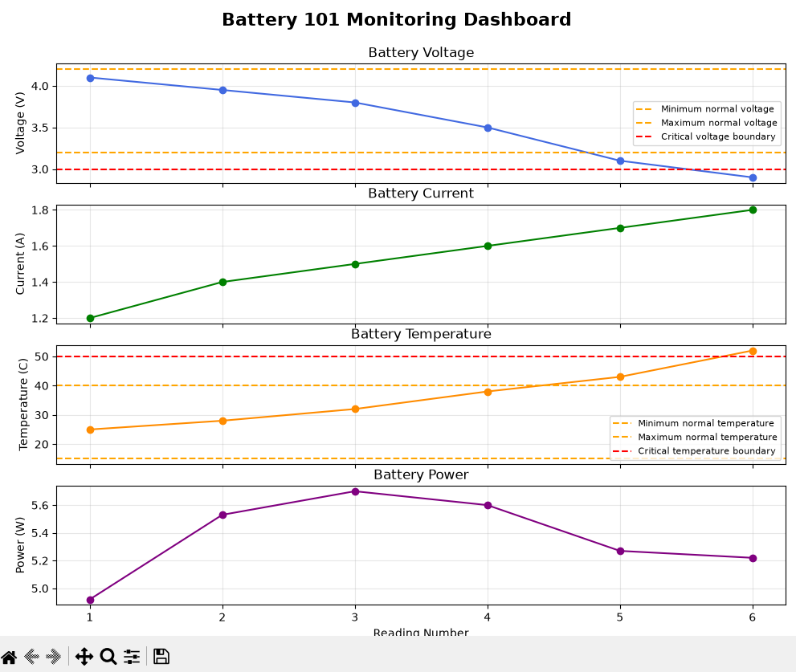
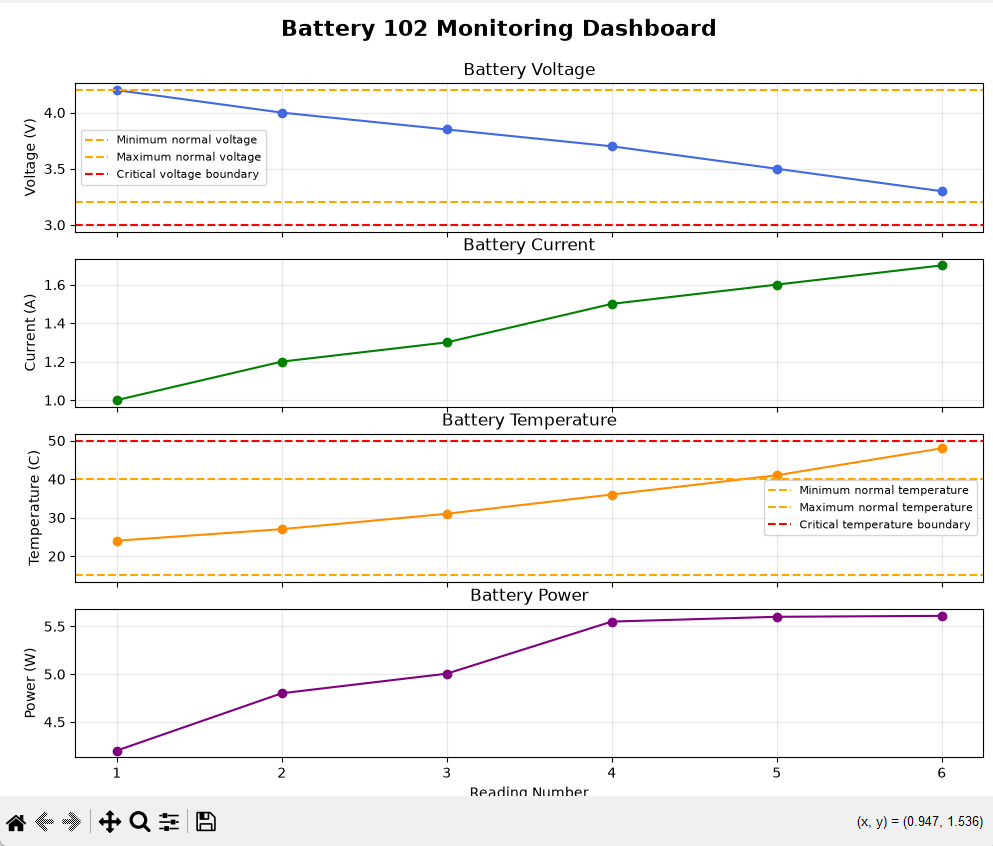
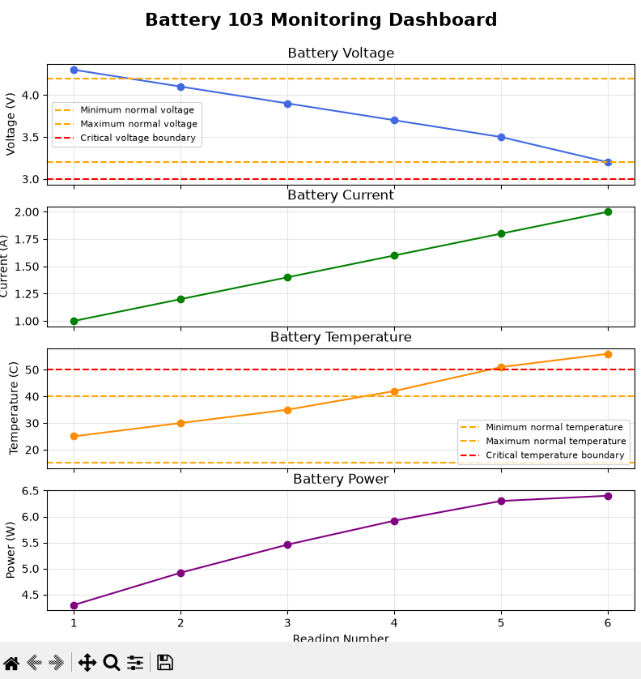

# System Design Documentation

## 1. System Overview

The Smart Battery Health Monitoring System is a Python-based
educational monitoring and diagnostic application designed
to process battery measurements, identify abnormal operating
conditions, store historical data, and visualize individual
battery performance.

The system accepts manually entered or synthetic voltage,
current, and temperature measurements. It calculates
electrical power and classifies battery operating conditions
using predefined thresholds.

The application supports multiple battery IDs, persistent CSV
storage, individual battery analysis, and graphical
visualization.

## 2. Engineering Objectives

- Monitor important battery electrical and thermal parameters.
- Identify abnormal voltage and temperature conditions.
- Calculate instantaneous electrical power.
- Validate user input before processing measurements.
- Maintain timestamped historical measurement records.
- Support independent analysis of multiple batteries.
- Prevent duplicate sample dataset imports.
- Visualize electrical and thermal trends.
- Verify software functionality through automated regression tests.

## 3. System Architecture

The architecture separates measurement acquisition,
validation, processing, storage, analysis, and visualization
into individual Python functions.

This functional organization improves readability,
maintainability, debugging, and testability.

## 4. Input Parameters

| Parameter | Unit | Description |
|---|---|---|
| Battery ID | Identifier | Identifies an individual battery |
| Voltage | V | Battery terminal voltage |
| Current | A | Simulated current magnitude |
| Temperature | °C | Battery temperature |
| Timestamp | ISO 8601 | Measurement recording time |

Voltage and current inputs must be non-negative finite
numbers. Temperature may be negative to support simulated
low-temperature operating conditions.

Invalid text, infinity, and NaN values are rejected.

## 5. Electrical Power Calculation

Instantaneous electrical power is calculated as:

P = V × I

Where:

- P = Electrical power in watts
- V = Battery voltage in volts
- I = Current in amperes

Example:

Voltage = 3.8 V

Current = 1.5 A

Power = 3.8 × 1.5 = 5.7 W

The calculated power is stored alongside the original
measurements for historical analysis and visualization.

## 6. Operating Condition Thresholds

The following thresholds are illustrative parameters
selected for educational simulation.

### Voltage Classification

| Voltage Range | Classification |
|---|---|
| V < 3.2 V | Low |
| 3.2 V ≤ V ≤ 4.2 V | Normal |
| V > 4.2 V | High |

A voltage below 3.0 V triggers a CRITICAL overall condition.

### Temperature Classification

| Temperature Range | Classification |
|---|---|
| T < 15°C | Too Cold |
| 15°C ≤ T ≤ 40°C | Normal |
| T > 40°C | High |

A temperature above 50°C triggers a CRITICAL overall condition.

### Overall Battery Condition

| Condition | Classification |
|---|---|
| V < 3.0 V OR T > 50°C | CRITICAL |
| Normal voltage AND normal temperature | HEALTHY |
| All remaining conditions | WARNING |

Critical conditions take priority over warning and healthy
conditions.

Current and electrical power are monitored and visualized
but are not used in the current classification algorithm.

## 7. Condition Classification Algorithm

The classification algorithm evaluates voltage and
temperature measurements using conditional statements.

Evaluating critical conditions first ensures that a
measurement exceeding a critical threshold cannot be
incorrectly classified as WARNING or HEALTHY.

## 8. Data Storage Design

The application stores measurement records in a CSV file
named `battery_readings.csv`.

Each record contains the following fields:

| Field | Description |
|---|---|
| timestamp | Measurement timestamp |
| battery_id | Battery identifier |
| voltage_v | Recorded voltage |
| current_a | Recorded current |
| temperature_c | Recorded temperature |
| power_w | Calculated electrical power |
| voltage_status | Voltage classification |
| temperature_status | Temperature classification |
| battery_status | Overall condition classification |

CSV storage was selected because it is lightweight,
human-readable, portable, and compatible with Python,
spreadsheet applications, and other data analysis tools.

Measurements retain their floating-point representation
during storage rather than being rounded to two decimal
places.

Displayed results are formatted separately for readability.

## 9. Sample Dataset Integration

The repository provides a synthetic dataset at:

`data/sample_battery_readings.csv`

The dataset contains 18 measurements from three simulated
batteries, with six measurements per battery.

| Battery ID | Healthy | Warning | Critical |
|---|---:|---:|---:|
| 101 | 4 | 1 | 1 |
| 102 | 4 | 2 | 0 |
| 103 | 2 | 2 | 2 |
| Total | 10 | 5 | 3 |

The dataset enables reproducible demonstrations of normal,
warning, and critical operating conditions.

Duplicate imports are prevented using a composite key
consisting of the timestamp and battery ID.

Existing records are preserved when their keys match
records in the sample dataset.

This approach assumes that the timestamp and battery ID
together uniquely identify a measurement.

## 10. Individual Battery Analysis

The system filters stored measurements according to the
selected battery ID.

The analysis provides:

- Total measurement count
- Minimum voltage
- Maximum voltage
- Average voltage
- Maximum temperature
- Healthy measurement count
- Warning measurement count
- Critical measurement count
- Percentage of healthy measurements

The healthy measurement percentage is calculated as:

Healthy percentage = (Healthy readings / Total readings) × 100

This percentage represents the proportion of readings
within the configured normal operating ranges. It is not
a measurement of electrochemical battery state of health.

## 11. Data Visualization

The application uses Matplotlib to generate a monitoring
dashboard for an individual battery.

Measurements are filtered by battery ID and sorted
chronologically before visualization.

Each dashboard contains four plots:

1. Battery voltage
2. Battery current
3. Battery temperature
4. Electrical power

Voltage and temperature plots include the configured normal
operating boundaries and critical boundaries.

### Battery 101

Demonstrates decreasing voltage, increasing current,
and a final critical undervoltage and high-temperature
condition.

### Battery 102

Demonstrates normal voltage measurements with elevated
temperatures during the final two measurements.

### Battery 103

Demonstrates an initial high-voltage warning followed by
critical high-temperature conditions.

The application saves the generated dashboard as
`battery_chart.png`. Generating another dashboard replaces
this output file.

## 12. Software Function Organization

| Function | Responsibility |
|---|---|
| get_number() | Numeric input validation |
| voltage_status() | Voltage classification |
| temperature_status() | Temperature classification |
| battery_status() | Overall condition classification |
| save_reading() | Persistent CSV storage |
| load_readings() | Retrieve historical measurements |
| load_sample_data() | Import synthetic measurements |
| take_reading() | Acquire and process user input |
| show_history() | Display recent saved records |
| show_summary() | Display aggregate monitoring statistics |
| analyze_readings() | Analyze all saved measurements |
| analyze_individual_battery() | Analyze a selected battery |
| make_chart() | Generate an individual battery dashboard |
| main() | Manage the interactive application menu |

## 13. Software Reliability and Testing

The application uses Python's built-in unittest framework.

The regression suite contains 30 automated test cases
covering:

- Voltage classification
- Temperature classification
- Critical threshold boundaries
- Overall battery condition classification
- Historical data analysis
- Individual battery analysis
- Sample dataset imports
- Duplicate import prevention
- CSV data persistence
- Measurement precision
- Invalid numeric input handling

Temporary directories isolate test data from actual
application records.

GitHub Actions automatically executes the regression
suite across Python 3.11, 3.12, and 3.13.

Dashboard generation has also been manually exercised
using all three synthetic battery scenarios.

## 14. Engineering Design Decisions

| Design Decision | Rationale |
|---|---|
| Python | Readability and rapid application development |
| Functional organization | Maintainability and independent testing |
| Threshold-based classification | Transparent and explainable decisions |
| CSV storage | Lightweight and portable measurement logging |
| Battery IDs | Independent monitoring of multiple batteries |
| Composite import key | Prevention of repeated sample imports |
| Matplotlib | Visualization of measurement trends |
| unittest | Repeatable software verification |
| GitHub Actions | Automated regression testing |

## 15. System Limitations

- Measurements are manually supplied or synthetically generated.
- No physical battery sensors are connected.
- Operating thresholds are educational and not universally applicable.
- Current and power do not trigger condition classifications.
- Battery state of charge is not estimated.
- Battery state of health is not estimated.
- Battery capacity degradation is not modeled.
- No hardware protection or automatic shutdown is implemented.
- Imported sample records are assumed to contain valid measurements.
- Dashboard generation is not covered by the current automated tests.
- The CSV storage design is intended for a small-scale application.

This application is not a certified battery management
or battery protection system.

## 16. Future Development Opportunities

Potential extensions include:

- Integration with ESP32 or Arduino sensor hardware
- Real-time voltage and current acquisition
- Battery-specific configurable operating thresholds
- Overcurrent condition detection
- State-of-charge estimation
- State-of-health estimation using capacity measurements
- Real-time alert generation
- SQLite database integration
- MQTT-based remote battery monitoring
- Automated visualization testing

## 17. Conclusion

The Smart Battery Health Monitoring System demonstrates
the integration of electrical engineering principles with
Python software development, measurement processing,
condition classification, data persistence, visualization,
and automated testing.

The system provides a reproducible educational platform
for exploring battery monitoring concepts and establishes
a foundation for future hardware-integrated monitoring
applications.
