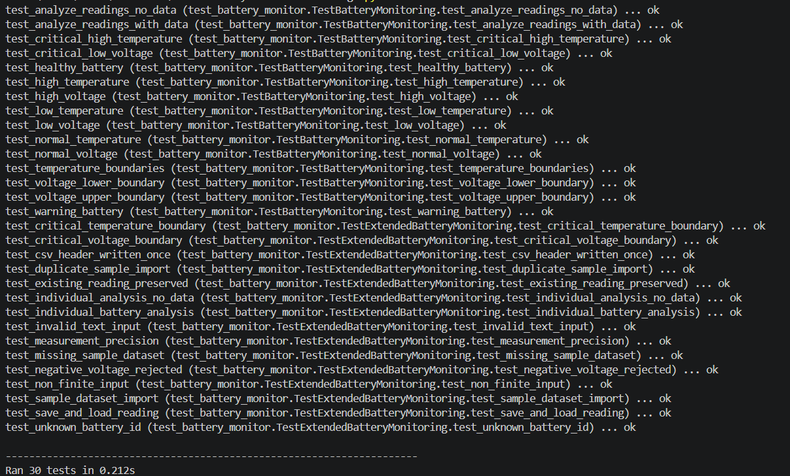
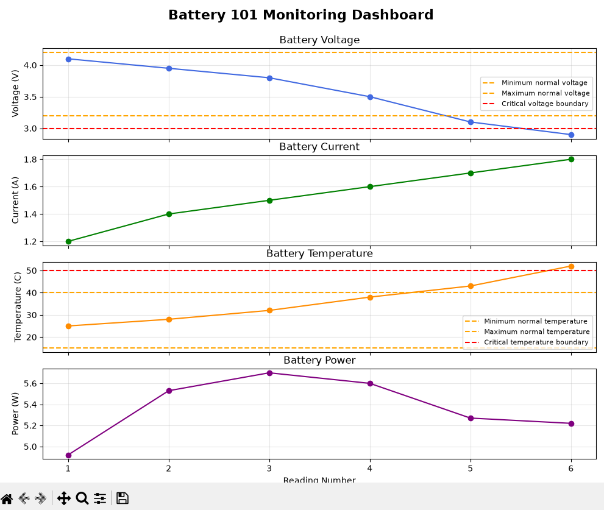
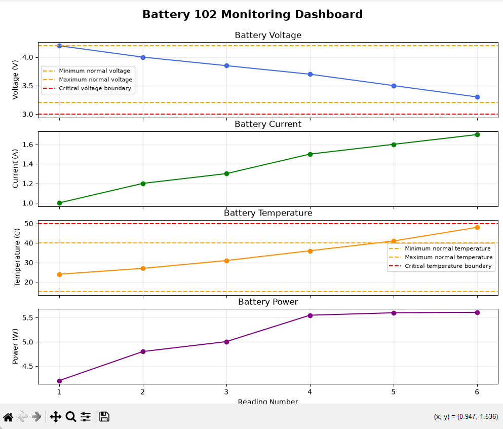
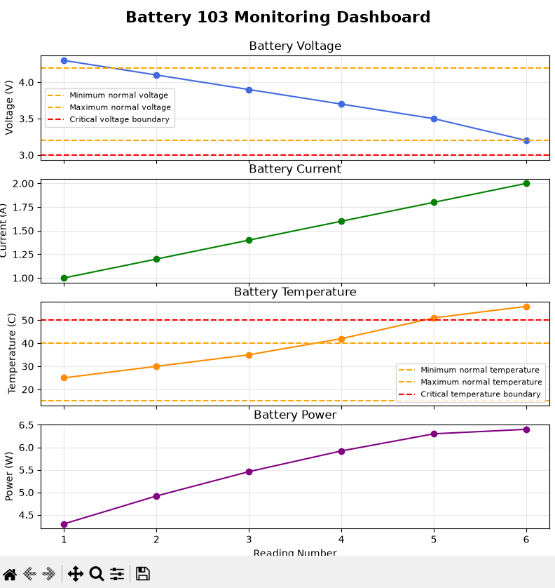

# Engineering Validation Report

## 1. Validation Overview

This document presents the software verification and
validation results of the Smart Battery Health Monitoring
System.

The validation process evaluates measurement processing,
condition classification, input validation, CSV storage,
individual battery analysis, sample dataset integration,
duplicate import prevention, and graphical visualization.

Testing was performed using synthetic battery measurements
and automated Python regression tests.

## 2. Testing Objectives

- Verify voltage and temperature classification.
- Verify electrical power calculations.
- Validate normal, warning, and critical operating conditions.
- Verify threshold boundary behavior.
- Reject invalid numeric inputs.
- Verify persistent CSV data storage.
- Prevent duplicate sample dataset imports.
- Verify individual battery analysis.
- Evaluate graphical visualization.
- Verify compatibility across multiple Python versions.

## 3. Test Environment

| Parameter | Configuration |
|---|---|
| Operating System | Windows |
| Development Environment | Visual Studio Code |
| Local Python Version | Python 3.12 |
| Testing Framework | Python unittest |
| Visualization Library | Matplotlib |
| Data Storage | CSV |
| Continuous Integration | GitHub Actions |
| CI Operating System | Ubuntu |
| CI Python Versions | 3.11, 3.12, 3.13 |
| Test Dataset | 18 synthetic measurements |
| Simulated Batteries | 3 |

## 4. Automated Regression Testing

The automated regression suite contains 30 test cases.

Execute the tests from the project root directory:

```bash
python -m unittest discover -s tests -v
```

### Local Test Results

| Metric | Result |
|---|---:|
| Total tests | 30 |
| Passed | 30 |
| Failed | 0 |
| Errors | 0 |
| Test success rate | 100% |
| Recorded execution time | 0.212 seconds |

The execution time represents one local test run and
may vary depending on the computing environment.

### Test Execution Evidence



## 5. Detailed Automated Test Results

| Test ID | Test Scenario | Result |
|---|---|---|
| TC-01 | Low voltage classification | PASS |
| TC-02 | Normal voltage classification | PASS |
| TC-03 | High voltage classification | PASS |
| TC-04 | Lower normal voltage boundary | PASS |
| TC-05 | Upper normal voltage boundary | PASS |
| TC-06 | Low temperature classification | PASS |
| TC-07 | Normal temperature classification | PASS |
| TC-08 | High temperature classification | PASS |
| TC-09 | Normal temperature boundaries | PASS |
| TC-10 | Healthy battery classification | PASS |
| TC-11 | Warning battery classification | PASS |
| TC-12 | Critical low-voltage classification | PASS |
| TC-13 | Critical high-temperature classification | PASS |
| TC-14 | Historical analysis with saved data | PASS |
| TC-15 | Historical analysis without saved data | PASS |
| TC-16 | Sample dataset import | PASS |
| TC-17 | Missing sample dataset handling | PASS |
| TC-18 | Duplicate sample import prevention | PASS |
| TC-19 | Preservation of existing measurements | PASS |
| TC-20 | Individual battery analysis | PASS |
| TC-21 | Unknown battery ID handling in analysis | PASS |
| TC-22 | Individual analysis without data | PASS |
| TC-23 | CSV saving and loading | PASS |
| TC-24 | Single CSV header generation | PASS |
| TC-25 | Measurement precision preservation | PASS |
| TC-26 | Invalid text input rejection | PASS |
| TC-27 | Non-finite numeric input rejection | PASS |
| TC-28 | Negative voltage input rejection | PASS |
| TC-29 | Critical voltage boundary | PASS |
| TC-30 | Critical temperature boundary | PASS |

All 30 test cases passed during local regression testing.

## 6. Boundary Condition Validation

Boundary tests verify that measurements near configured
thresholds receive the expected classifications.

| Test Input | Expected Classification | Result |
|---|---|---|
| Voltage = 3.2 V | Normal voltage | PASS |
| Voltage = 4.2 V | Normal voltage | PASS |
| Temperature = 15 C | Normal temperature | PASS |
| Temperature = 40 C | Normal temperature | PASS |
| Voltage = 3.0 V, temperature = 30 C | WARNING | PASS |
| Voltage = 2.999 V, temperature = 30 C | CRITICAL | PASS |
| Voltage = 3.8 V, temperature = 50 C | WARNING | PASS |
| Voltage = 3.8 V, temperature = 50.001 C | CRITICAL | PASS |

These results confirm the expected inclusive and
exclusive boundaries of the implemented algorithm.

## 7. Synthetic Dataset Validation

The sample dataset is available at:

[Sample Battery Readings](../data/sample_battery_readings.csv)

It contains 18 synthetic measurements distributed across
three battery IDs.

| Battery ID | Readings | Healthy | Warning | Critical |
|---|---:|---:|---:|---:|
| 101 | 6 | 4 | 1 | 1 |
| 102 | 6 | 4 | 2 | 0 |
| 103 | 6 | 2 | 2 | 2 |
| Total | 18 | 10 | 5 | 3 |

### Overall Condition Distribution

| Classification | Measurements | Percentage |
|---|---:|---:|
| HEALTHY | 10 | 55.6% |
| WARNING | 5 | 27.8% |
| CRITICAL | 3 | 16.7% |

Percentages are rounded independently.

The dataset provides reproducible examples of normal
operation, undervoltage, high voltage, elevated temperature,
and critical operating conditions.

## 8. Sample Import and Data Persistence

The initial local sample import produced the following
observed output:

```text
Sample readings imported: 18
Duplicate readings skipped: 0
```

Automated regression testing also verified that importing
the dataset repeatedly does not increase the total number
of stored records beyond 18.

The duplicate detection mechanism uses the combination
of measurement timestamp and battery ID.

CSV testing verified:

- Successful measurement storage and retrieval.
- Preservation of existing measurements.
- Single header generation.
- Preservation of floating-point measurement precision.
- Prevention of repeated sample dataset imports.

Temporary directories were used during automated testing
to protect existing application data.

## 9. Individual Battery Dashboard Validation

Dashboard generation was manually exercised for all
three synthetic batteries.

Each dashboard contains voltage, current, temperature,
and electrical power plots.

Voltage and temperature plots include the configured
normal and critical operating boundaries.

### Battery 101



| Parameter | Dataset Value |
|---|---:|
| Maximum voltage | 4.10 V |
| Minimum voltage | 2.90 V |
| Maximum current | 1.80 A |
| Maximum temperature | 52 C |
| Maximum power | 5.70 W |
| Healthy readings | 4 |
| Warning readings | 1 |
| Critical readings | 1 |

Battery 101 demonstrates decreasing voltage and increasing
temperature.

The final measurement crosses both the critical
undervoltage and high-temperature thresholds.

Dashboard generation and visual review: PASS.

### Battery 102



| Parameter | Dataset Value |
|---|---:|
| Maximum voltage | 4.20 V |
| Minimum voltage | 3.30 V |
| Maximum current | 1.70 A |
| Maximum temperature | 48 C |
| Maximum power | 5.61 W |
| Healthy readings | 4 |
| Warning readings | 2 |
| Critical readings | 0 |

Battery 102 demonstrates normal voltage conditions with
elevated temperatures during the final two measurements.

The temperature exceeds the normal operating boundary
but remains below the critical temperature threshold.

Dashboard generation and visual review: PASS.

### Battery 103



| Parameter | Dataset Value |
|---|---:|
| Maximum voltage | 4.30 V |
| Minimum voltage | 3.20 V |
| Maximum current | 2.00 A |
| Maximum temperature | 56 C |
| Maximum power | 6.40 W |
| Healthy readings | 2 |
| Warning readings | 2 |
| Critical readings | 2 |

Battery 103 demonstrates an initial high-voltage
warning followed by critical high-temperature conditions.

The final two measurements exceed the configured
critical temperature threshold.

Dashboard generation and visual review: PASS.

## 10. Continuous Integration

GitHub Actions automatically executes the regression
suite when changes are pushed to the repository or
pull requests are submitted.

The workflow also supports manual execution.

[](https://github.com/ShanmukhJonnalagadda/Smart-Battery-Health-Monitoring/actions/workflows/tests.yml)

| Python Version | Configured Tests | Test Step Result |
|---|---:|---|
| Python 3.11 | 30 | PASS |
| Python 3.12 | 30 | PASS |
| Python 3.13 | 30 | PASS |

A complete workflow is configured to execute 90 test
cases across the three Python environments.

Continuous integration improves regression detection
and verifies compatibility across Python versions.

[View GitHub Actions Results](https://github.com/ShanmukhJonnalagadda/Smart-Battery-Health-Monitoring/actions)

## 11. Requirements Verification Matrix

| Requirement | Verification Method | Status |
|---|---|---|
| Voltage classification | Automated tests | PASS |
| Temperature classification | Automated tests | PASS |
| Overall condition classification | Automated tests | PASS |
| Critical boundary detection | Automated tests | PASS |
| Electrical power calculation | Automated precision test | PASS |
| Numeric input validation | Automated tests | PASS |
| CSV data persistence | Automated tests | PASS |
| Measurement precision | Automated tests | PASS |
| Sample dataset import | Automated and manual tests | PASS |
| Duplicate import prevention | Automated tests | PASS |
| Individual battery analysis | Automated tests | PASS |
| Historical data analysis | Automated tests | PASS |
| Individual dashboard generation | Manual demonstration | PASS |
| Dashboard threshold visualization | Visual review | PASS |
| Python version compatibility | GitHub Actions | PASS |
| Hardware sensor integration | Not implemented | NOT TESTED |
| Physical battery safety | Outside project scope | NOT TESTED |

## 12. Validation Limitations

- All battery scenarios use synthetic measurements.
- No physical battery sensors were tested.
- Thresholds are illustrative rather than certified safety limits.
- Dashboard generation was manually demonstrated and visually
  reviewed but is not covered by the automated regression suite.
- Automated test success does not establish complete code coverage.
- Battery state of charge and state of health are not estimated.
- Hardware protection mechanisms are outside the project scope.
- Long-duration operation and large-scale storage performance
  have not been evaluated.
- Imported CSV measurements are assumed to contain valid values.
- Automated chart handling of malformed data has not been tested.

## 13. Future Validation Opportunities

- Automated dashboard generation tests.
- Corrupted CSV and malformed measurement testing.
- Large-scale dataset performance testing.
- Real-time sensor integration testing.
- Battery-specific threshold configuration testing.
- Hardware-in-the-loop testing.
- Sensor calibration and measurement accuracy evaluation.

## 14. Conclusion

The Smart Battery Health Monitoring System successfully
completed all 30 local automated regression tests.

The application demonstrated synthetic dataset integration,
duplicate import prevention, individual battery analysis,
and graphical visualization across three simulated batteries.

Continuous integration testing further verified the
implemented regression suite across Python 3.11, 3.12,
and 3.13.

The results support the intended educational software
monitoring and diagnostic functionality.

They do not establish physical battery measurement accuracy,
electrochemical state of health, or hardware safety
certification.
